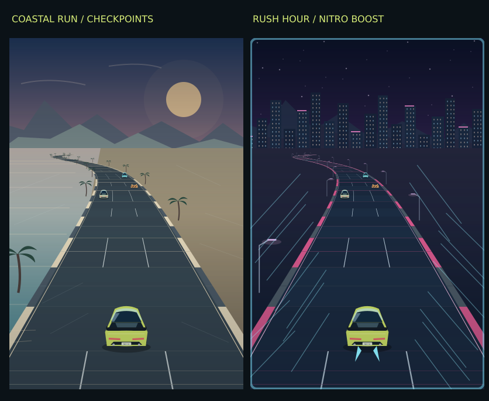

# Neon Drive

A React Native driving game that turns your phone into a steering wheel. All game text is in English.



## Install on Android

[Download NeonDrive_Android_ARM64.apk](downloads/NeonDrive_Android_ARM64.apk?raw=true)

Requires Android 7.0 or newer and an ARM64 device. Download the APK, open it on your phone, and allow installation from that source if Android prompts you. Launch **Neon Drive**. No Expo Go or computer connection is required to play.

## Controls and features

- Tilt the phone left or right to steer using the accelerometer.
- Hold **Accelerate**, **Brake**, or **Nitro**. Nitro is available in arcade modes.
- Use **Calibrate** to reset the neutral steering position.
- Touch steering is available as an alternative.
- View speed, score, remaining time, car condition, and sensor readings.
- The gyroscope displays rotation readings; steering uses accelerometer input.
- Pause, adjust steering sensitivity, switch views, and review the driving report.

## Game modes

| Mode | Gameplay |
| --- | --- |
| Driving Academy | Follow traffic lights and control your speed. |
| Coastal Run | Drive along a coastal road with curves, traffic, nitro, and checkpoints. |
| Neon Express | Navigate night traffic and build near-miss combos. |
| Rush Hour | Beat the clock through the heaviest traffic and gain time at checkpoints. |

Reach the destination before time runs out and keep the car in good condition.

## Technology

React Native, JavaScript, Expo Sensors, React Native SVG, Hermes, Gradle, and the Android SDK/NDK.

## Run the source

Install Node.js and npm, then run:

```sh
npm ci
npm start
```

The development command starts Expo Go. This is separate from the standalone APK above, which runs without Expo Go.

## Test

```sh
npm test
```

The 15 engine tests cover driving, braking, traffic rules, collisions, nitro, combos, checkpoints, and roadblocks.

## Build an Android APK

Install a full JDK 17 (including javac and jlink), Android SDK / build tools 37, and NDK 27.1.12297006. Set ANDROID_HOME or configure android/local.properties. The Gradle wrapper uses version 9.4.1.

On Windows:

```powershell
cd android
.\gradlew.bat :app:assembleRelease -PreactNativeArchitectures=arm64-v8a --no-parallel --max-workers=1
```

On macOS/Linux:

```sh
cd android
./gradlew :app:assembleRelease -PreactNativeArchitectures=arm64-v8a --no-parallel --max-workers=1
```

Without signing credentials, the release output is unsigned and must be signed before installation. To sign an update, configure NEON_STORE_FILE, NEON_STORE_PASSWORD, and NEON_KEY_PASSWORD in your private Gradle user properties. The original key alias is neondrive. Keep the original signing key private to preserve update compatibility.

Release outputs are in android/app/build/outputs/apk/release/. The prebuilt signed APK is in downloads/. Release keys, passwords, dependencies, build caches, and local SDK paths are excluded from this repository.

## Validation

The included APK passed release build, signature, archive integrity, and 16 KB alignment checks. See BUILD_VALIDATION.json. It has not been tested on a physical Android phone.
